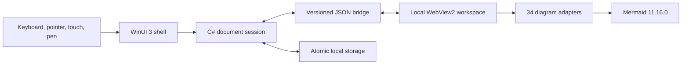

# Architecture

Mermaid Studio uses a native document shell and one isolated local web workspace.

Architecture decisions:

- [ADR 0001: native and web boundary](0001-native-web-boundary.md)
- [ADR 0002: adapter compatibility contract](0002-adapter-contract.md)
- [ADR 0003: local-content security model](0003-security-model.md)
- [ADR 0004: portable unpackaged release](0004-portable-release.md)
